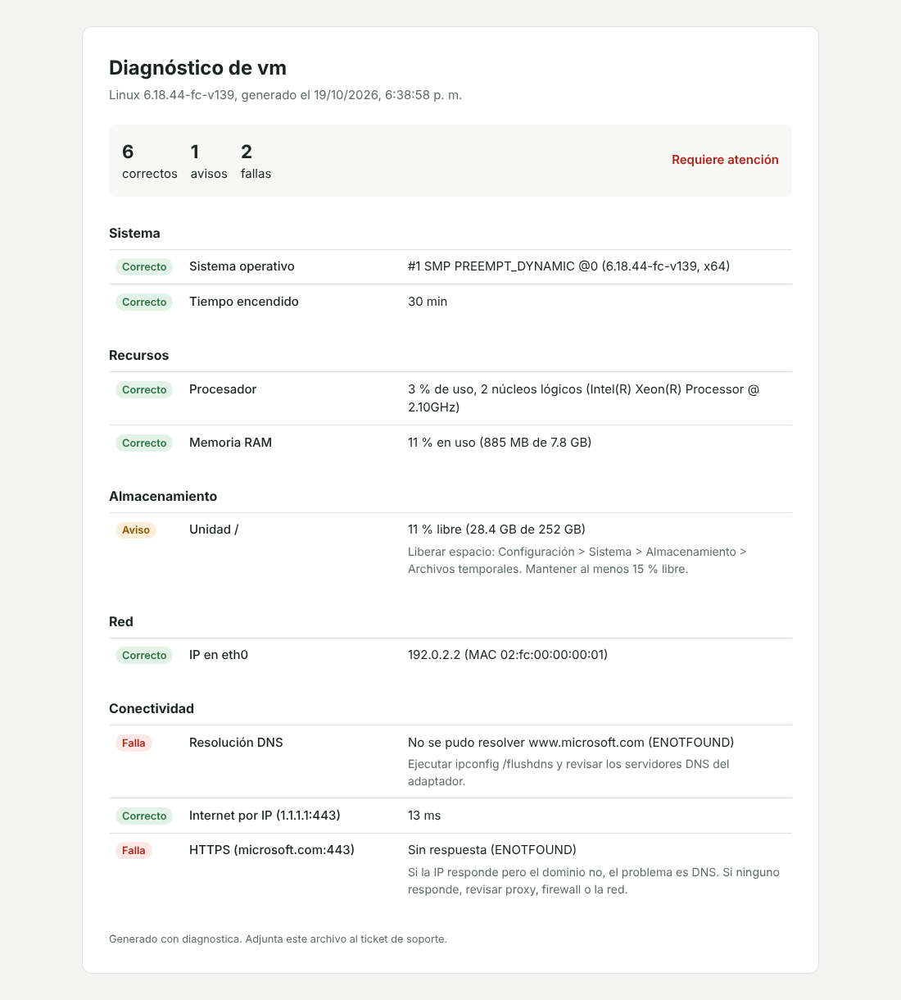

# diagnostica

Herramienta de terminal que revisa en segundos lo primero que uno mira en soporte cuando alguien dice "mi computador no funciona": sistema, procesador, memoria, discos, red y salida a internet. Muestra el resultado con colores, una recomendación por cada problema y puede generar un informe en HTML para adjuntar al ticket.

Así se ve en un equipo sin DNS (en Windows las unidades salen como `C:`, `D:`):

```text
Sistema
   OK   Sistema operativo              Linux 6.18 (x64)
   OK   Tiempo encendido               31 min

Recursos
   OK   Procesador                     2 % de uso, 2 núcleos
   OK   Memoria RAM                    10 % en uso (800 MB de 7.8 GB)

Almacenamiento
 AVISO  Unidad /                       11 % libre (28.4 GB de 252 GB)
                                       -> Liberar espacio. Mantener al menos 15 % libre.

Conectividad
 FALLA  Resolución DNS                 No se pudo resolver www.microsoft.com
                                       -> Ejecutar ipconfig /flushdns y revisar los DNS del adaptador.
   OK   Internet por IP (1.1.1.1:443)  10 ms
 FALLA  HTTPS (microsoft.com:443)      Sin respuesta
```

El mismo diagnóstico como informe:



Compara la conexión por IP con la conexión por nombre de dominio. Si la IP responde y el dominio no, el problema es de DNS y no de la red.

## Usarla

En Windows, en PowerShell, dentro de la carpeta:

```powershell
npm.cmd install
npm.cmd run informe
```

Hace el diagnóstico y abre el informe en el navegador. Otras opciones, después de `npm run build`:

```bash
node dist/cli.js                      # solo en la terminal
node dist/cli.js --html informe.html  # guarda el informe
node dist/cli.js --solo red,conectividad
node dist/cli.js --json > equipo.json
node dist/cli.js --sin-red            # solo lo local
```

Termina con código `0` si todo está bien y `1` si algo falló, para usarla desde scripts.

## Con qué está hecha

Node.js y TypeScript, sin dependencias en producción. Cada revisión es un archivo en `src/checks/` y corren en paralelo con un tiempo límite, así si una se cuelga el resto del informe sale igual. Para medir la latencia abro una conexión al puerto 443 en vez de hacer ping, porque en muchas redes de empresa el ping está bloqueado.

```bash
npm test
npm run typecheck
```

Pendiente: revisar servicios de Windows (Spooler, Windows Update) y la batería en portátiles.
